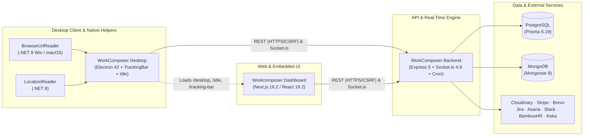

<div align="center">


# WorkComposer

**Full-Stack Workforce Time Tracking, Productivity Analytics & Desktop Telemetry Platform**

[](https://nextjs.org/)
[](https://react.dev/)
[](https://www.typescriptlang.org/)
[](https://tailwindcss.com/)
[](https://expressjs.com/)
[](https://www.prisma.io/)
[](https://www.postgresql.org/)
[](https://socket.io/)
[](https://www.electronjs.org/)
[](https://dotnet.microsoft.com/)

WorkComposer combines a **Node.js / Express + Socket.io API backend**, a **Next.js 16 web & desktop-embedded dashboard**, an **Electron 42 desktop tracking application**, and **.NET 8 native helpers** for Windows and macOS active-browser URL detection and geolocation reading.

</div>

---

## Table of Contents

1. [System Architecture](#system-architecture)
2. [Platform Modules & UI Showcase](#platform-modules--ui-showcase)
3. [Core Capabilities](#core-capabilities)
4. [Repository Structure](#repository-structure)
5. [Tech Stack](#tech-stack)
6. [Prerequisites](#prerequisites)
7. [Environment Variables](#environment-variables)
8. [Local Development Setup](#local-development-setup)
9. [Available Scripts & Production Builds](#available-scripts--production-builds)
10. [Key Architectural Highlights](#key-architectural-highlights)

---

## System Architecture



---

## Platform Modules & UI Showcase

| Module | Highlights |
| --- | --- |
| **Dashboard & Live Attendance** | Team & Personal Home views, live Work/Break tracking, half-open zoned attendance intervals, active timer merging, and first/last punch bounds. |
| **Work Details (Per-Minute Activity & Screenshots)** | Screenshot gallery sorted newest-first, user-timezone timestamps, 1-minute keystroke/mouse telemetry buckets, and aligned `Activity %` & `Idle Time`. |
| **Web & App Usage Analytics** | Case-insensitive domain normalization scoped per organization, Top-N horizontal bar charts, searchable `Full list`, and `Detailed log` drill-downs. |
| **Productivity Categorization** | Interactive `Productive`, `Neutral`, and `Unproductive` classification boards with organization-wide rules and instant portal context menus. |
| **Live Location Tracking** | Leaflet Street & Esri Satellite map with `MarkerClusterGroup`, range-aware `WORK TIME` / `BREAK TIME` tiles, scroll-stable popups, and dark-mode styling. |
| **Settings & RBAC** | Role-based privileges (`owner`, `admin`, `manager`, `user`, custom roles), multi-manager assignments, and live organization-wide settings propagation. |
| **Electron Desktop Tracker & Floating Bar** | System-tray desktop client, `/idle` detection overlay, always-on-top `/tracking-bar` with live Work/Break timers, and offline telemetry queues. |

<table>
  <tr>
    <td width="50%" align="center">
      <strong>Dashboard Overview & Live Reports</strong><br /><br />
      
    </td>
    <td width="50%" align="center">
      <strong>Attendance & Session Tracking</strong><br /><br />
      
    </td>
  </tr>
  <tr>
    <td width="50%" align="center">
      <strong>Screenshots & Work Details Telemetry</strong><br /><br />
      
    </td>
    <td width="50%" align="center">
      <strong>Web & App Usage Analytics</strong><br /><br />
      
    </td>
  </tr>
  <tr>
    <td colspan="2" align="center">
      <strong>Electron Desktop App & Tracking Mode</strong><br /><br />
      
    </td>
  </tr>
</table>

---

## Core Capabilities

- **Time Tracking & Attendance Engine**
  - Real-time work and break session tracking with active-timer reconciliation, overlapping-interval merging, manual time editing/requests, shift scheduling, and timezone-aware daily reporting (`Attendance`, `My Report`, `Home`).
- **Screenshot & Per-Minute Activity Telemetry**
  - Automated screenshot capture with offline safe-retain queuing, chronological timeline inspection, and 1-minute activity buckets scoring keyboard/mouse telemetry (`Work Details`).
- **Web, App Usage & Productivity Classification**
  - Tracks foreground applications and active browser URLs/domains, normalizes domains case-insensitively per organization, ranks top apps/websites with full modal drill-downs, and categorizes usage into `Productive`, `Neutral`, and `Unproductive` buckets.
- **Project & Task Tracking**
  - Project/task lifecycle management, time attribution per task, comments, deleted-task recovery, and external integrations (Jira, Asana, Slack, Keka, BambooHR).
- **Live Location Tracking**
  - Interactive Leaflet + OpenStreetMap / Esri Satellite team map with marker clustering, live work/break summaries aligned to the selected date range, and scroll-stable marker popups.
- **Organization RBAC, Multi-Manager Scoping & Settings Propagation**
  - Role-based access control (`owner`, `admin`, `manager`, `user`, plus custom roles/privileges), multiple assigned managers per employee, per-user and organization-wide tracking settings, and live Socket.io propagation to connected clients.
- **Electron Desktop Tracker & Floating `TrackingBar`**
  - Desktop agent with system-tray lifecycle, idle-detection window (`/idle`), floating always-on-top `TrackingBar` (`/tracking-bar`) with live Work/Break status, durable telemetry queuing, and native browser URL/location integration.
- **Notifications, Billing & Public API**
  - Real-time in-app & desktop notifications, Stripe subscription billing & webhook handling, CSV/report exports, audit logs, and API key-authenticated `/api/v1` endpoints.

---

## Repository Structure

```text
WorkComposer/
├── WorkComposer Backend/        # Express 5 API, Socket.io server, Prisma (PostgreSQL) & Mongoose, cron schedulers
│   ├── prisma/                  # Prisma schema, migrations, and backfill utilities
│   ├── scripts/                 # Maintenance & migration utilities
│   ├── src/
│   │   ├── config/              # Environment, DB, Prisma, Stripe, Cloudinary configs
│   │   ├── controllers/         # REST endpoint handlers (auth, sessions, activity, attendance, usage, location, etc.)
│   │   ├── cron/                # Scheduled email report jobs
│   │   ├── db/                  # Repository abstraction supporting PostgreSQL (Prisma) & MongoDB (Mongoose)
│   │   ├── jobs/                # External integration sync jobs (Jira, BambooHR)
│   │   ├── middleware/          # Auth, CSRF, RBAC permissions, security headers, rate limiting
│   │   ├── models/              # Mongoose schemas
│   │   ├── routes/              # /api/* and /api/v1/* Express routers
│   │   ├── security/            # Effective auth context & multi-tenant scoping helpers
│   │   ├── services/            # Attendance/daily reports, team-day intelligence, notifications, email
│   │   ├── socket/              # Real-time Socket.io organization & user channels
│   │   ├── templates/           # Daily/weekly report & alert email templates
│   │   └── utils/               # Timezone, overlap calculation, geocoder, avatar, sanitization utilities
│   └── server.js                # HTTP + Socket.io entrypoint (default port 5000)
│
├── Workcomposer Dashboard/      # Next.js 16 (App Router) + React 19 + Tailwind CSS v4 frontend
│   └── src/
│       ├── api/                 # Axios client with CSRF & token refresh handling
│       ├── app/
│       │   ├── authenticate/    # Login, registration, invite acceptance, password reset, email verification
│       │   ├── dashboard/       # Web dashboard: time-tracking, task-management, user-management, settings, notifications
│       │   ├── desktop/         # Embedded desktop shell route
│       │   ├── idle/            # Desktop idle timeout prompt route
│       │   └── tracking-bar/    # Floating desktop timer bar route
│       ├── components/          # Shared UI components, notifications, modals, theme controls
│       ├── context/             # Dashboard, Desktop, Project, Theme, TimeTracking, Timer React contexts
│       ├── hooks/               # Custom hooks (notifications, timezone, screenshot capture alerts)
│       └── utils/               # Timezone conversion, chart/timeline helpers, user profile mappers
│
├── WorkComposer Desktop/        # Electron 42 desktop client & background telemetry agent
│   ├── electron/                # Main process, preload bridge, durable queues, shift/window/idle policies
│   ├── renderer/                # Desktop renderer UI & fallback views
│   └── resources/               # Packaged LocationReader & MacBrowserReader helpers
│
└── BrowserUrlReader/            # .NET 8 native browser URL readers (Windows UIAutomation & macOS support)
    ├── BrowserReader.cs
    ├── MacBrowserReader.cs
    └── Mac/
```

---

## Tech Stack

| Layer | Technologies |
| --- | --- |
| **Backend (`WorkComposer Backend`)** | Node.js (ESM), Express 5, Socket.io 4.8, PostgreSQL + Prisma 6.19, MongoDB + Mongoose 9, JWT, `bcryptjs`, Stripe, Cloudinary, Brevo / Nodemailer, `node-cron`, `date-fns-tz`, `express-rate-limit` |
| **Frontend (`Workcomposer Dashboard`)** | Next.js 16.2 (App Router, Webpack dev), React 19.2, TypeScript 6, Tailwind CSS 4, Chart.js / `react-chartjs-2`, Recharts, Leaflet / `react-leaflet` / `react-leaflet-cluster`, Socket.io Client, Axios, Lucide React |
| **Desktop (`WorkComposer Desktop`)** | Electron 42, `electron-builder` 26, `electron-store`, `active-win`, `screenshot-desktop`, `sharp`, `uiohook-napi` |
| **Native Helpers (`BrowserUrlReader`)** | .NET 8 (`net8.0-windows` / `net8.0`), C#, `Interop.UIAutomationClient` |

---

## Prerequisites

- **Node.js** `v20+` (verified with `v24.13.1`) and **npm** (`v10+` / `v11+`)
- **PostgreSQL** (`DATABASE_URL`) and/or **MongoDB** (`MONGO_URI`), depending on `DATABASE_PROVIDER`
- **.NET 8 SDK** *(only required when rebuilding `BrowserUrlReader` or `LocationReader` native helpers)*
- **Windows / macOS** desktop environment for Electron native hooks (`uiohook-napi`, `screenshot-desktop`, `active-win`)

---

## Environment Variables

Create `.env` inside `WorkComposer Backend/` and `.env.local` inside `Workcomposer Dashboard/` before running locally. Never commit `.env*` files.

### Backend (`WorkComposer Backend/.env`)

| Variable | Purpose | Example Placeholder |
| --- | --- | --- |
| `PORT` | HTTP / Socket.io server port | `5000` |
| `DATABASE_PROVIDER` | Active DB provider (`postgres` or `mongo`) | `postgres` |
| `DATABASE_URL` | PostgreSQL connection string for Prisma | `postgresql://<user>:<password>@localhost:5432/workcomposer?schema=public` |
| `MONGO_URI` | MongoDB connection string (when using Mongoose / migration) | `mongodb://localhost:27017/workcomposer` |
| `JWT_SECRET` | Secret used to sign access/refresh tokens | `<random-strong-secret>` |
| `FRONTEND_URL` / `CLIENT_URL` | Allowed CORS frontend origin | `http://localhost:3000` |
| `SERVER_URL` / `BACKEND_URL` | Public/local backend base URL for OAuth callbacks & links | `http://localhost:5000` |
| `CLOUDINARY_CLOUD_NAME`, `CLOUDINARY_API_KEY`, `CLOUDINARY_API_SECRET` | Media storage for avatars & screenshots | `<cloudinary-credentials>` |
| `BREVO_API_KEY`, `EMAIL_FROM` | Transactional & scheduled report emails | `<brevo-api-key>`, `noreply@example.com` |
| `STRIPE_SECRET_KEY`, `STRIPE_PUBLISHABLE_KEY` | Billing plans & Stripe webhook handling | `<stripe-keys>` |
| `GOOGLE_CLIENT_ID`, `GOOGLE_CLIENT_SECRET`, `GOOGLE_REDIRECT_URI` | Google OAuth sign-in | `<google-oauth-credentials>` |
| `MICROSOFT_CLIENT_ID`, `MICROSOFT_CLIENT_SECRET`, `MICROSOFT_TENANT_ID`, `MICROSOFT_REDIRECT_URI` | Microsoft OAuth sign-in | `<microsoft-oauth-credentials>` |
| `JIRA_CLIENT_ID`, `JIRA_CLIENT_SECRET`, `JIRA_REDIRECT_URI` | Jira project/task integration | `<jira-oauth-credentials>` |
| `ASANA_CLIENT_ID`, `ASANA_CLIENT_SECRET`, `ASANA_REDIRECT_URI` | Asana integration | `<asana-oauth-credentials>` |
| `SLACK_CLIENT_ID`, `SLACK_CLIENT_SECRET`, `SLACK_SIGNING_SECRET`, `SLACK_REDIRECT_URI` | Slack integration | `<slack-app-credentials>` |
| `IPINFO_TOKEN` | IP ISP/org lookup for location tracking | `<ipinfo-token>` |

### Dashboard (`Workcomposer Dashboard/.env.local`)

| Variable | Purpose | Example Placeholder |
| --- | --- | --- |
| `NEXT_PUBLIC_API_URL` | Backend REST API base URL | `http://localhost:5000/api` |
| `NEXT_PUBLIC_API_ORIGIN` | Backend HTTP origin | `http://localhost:5000` |
| `NEXT_PUBLIC_SOCKET_URL` | Socket.io server origin | `http://localhost:5000` |

---

## Local Development Setup

### 1. Install Dependencies

```bash
cd "WorkComposer Backend" && npm install
cd "../Workcomposer Dashboard" && npm install
cd "../WorkComposer Desktop" && npm install
```

### 2. Initialize Database (PostgreSQL + Prisma)

```bash
cd "WorkComposer Backend"
npx prisma generate
npx prisma migrate deploy
```

### 3. Run All Services Locally

1. **Start Backend (`http://localhost:5000`):**
   ```bash
   cd "WorkComposer Backend"
   npm run dev   # or: npm start
   ```
2. **Start Web Dashboard (`http://localhost:3000`):**
   ```bash
   cd "Workcomposer Dashboard"
   npm run dev
   ```
3. **Start Electron Desktop App:**
   ```bash
   cd "WorkComposer Desktop"
   npm run electron
   ```

---

## Available Scripts & Production Builds

### Backend (`WorkComposer Backend/package.json`)
- `npm start` — Run `node server.js`
- `npm run dev` — Run `nodemon server.js`

### Dashboard (`Workcomposer Dashboard/package.json`)
- `npm run dev` — Run Next.js dev server (`next dev --webpack`)
- `npm run build` — Build production Next.js bundle (`next build`)
- `npm start` — Start Next.js production server (`next start`)
- `npm run lint` — Run ESLint (`eslint`)
- `npx tsc --noEmit --incremental false` — Run strict TypeScript typecheck

### Desktop (`WorkComposer Desktop/package.json`)
- `npm run electron` — Launch Electron (`electron .`)
- `npm run pack` — Package unpacked desktop directory (`electron-builder --dir`)
- `npm run dist` — Build platform installer (`electron-builder` — NSIS on Windows, DMG on macOS)

### Native Browser URL Reader (`BrowserUrlReader/`)
```bash
dotnet publish BrowserUrlReader/BrowserUrlReader.csproj -c Release -r win-x64
```

---

## Key Architectural Highlights

- **Timezone-Aware Overlap & Active Timer Accounting:** Attendance, overview, usage, and live location summaries use half-open zoned day bounds (`getZonedDayRange`) and interval-overlap merging (`calculateIntervalOverlap`) combined with running `Timer` fallback evaluation up to `evalNow`, avoiding cross-midnight drift and overlapping session double-counting.
- **Organization-Wide Real-Time Sync:** Tracking setting updates, RBAC changes, user profile/timezone updates, and notifications propagate across web and Electron windows via Socket.io organization rooms and CSRF-protected endpoints.
- **Multi-Tenant & Multi-Manager Scoping:** Controllers enforce `callerOrgId` isolation (`404` zero-disclosure on cross-tenant lookups) and resolve reporting access across `owner`/`admin`, multi-manager assignments (`managers` + legacy `manager`), and individual users.
- **Resilient Desktop Telemetry:** Screenshot and activity payloads persist through offline queues (`durableTelemetryQueue.js`, `offlineScreenshotQueue.js`) with timestamp preservation and native active-window/browser URL capture.
