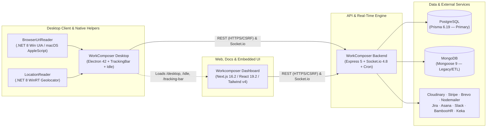

<div align="center">


# WorkComposer

**Full-Stack Workforce Time Tracking, Productivity Analytics & Desktop Telemetry Platform**

[](https://nextjs.org/)
[](https://react.dev/)
[](https://www.typescriptlang.org/)
[](https://tailwindcss.com/)
[](https://expressjs.com/)
[](https://www.prisma.io/)
[](https://www.postgresql.org/)
[](https://socket.io/)
[](https://www.electronjs.org/)
[](https://dotnet.microsoft.com/)

WorkComposer combines a **Node.js / Express 5 + Socket.io API backend** backed by **PostgreSQL (Prisma 6.19)**, a **Next.js 16 web, documentation & desktop-embedded dashboard**, an **Electron 42 desktop tracking application**, and **.NET 8 native helpers** for Windows and macOS active-browser URL detection and Windows geolocation reading.

</div>

---

## Table of Contents

1. [Component Documentation](#component-documentation)
2. [System Architecture](#system-architecture)
3. [Platform Modules & UI Showcase](#platform-modules--ui-showcase)
4. [Core Capabilities](#core-capabilities)
5. [Repository Structure](#repository-structure)
6. [Tech Stack](#tech-stack)
7. [Prerequisites](#prerequisites)
8. [Environment Variables](#environment-variables)
9. [Local Development Setup](#local-development-setup)
10. [Available Scripts & Production Builds](#available-scripts--production-builds)
11. [Key Architectural Highlights](#key-architectural-highlights)

---

## Component Documentation

| Component | Path | Documentation |
| --- | --- | --- |
| **Web & Embedded Dashboard** | `Workcomposer Dashboard/` | [Workcomposer Dashboard/README.md](./Workcomposer%20Dashboard/README.md) |
| **REST & Socket.io Backend** | `WorkComposer Backend/` | [WorkComposer Backend/README.md](./WorkComposer%20Backend/README.md) |
| **MongoDB → PostgreSQL ETL** | `WorkComposer Backend/scripts/migration/` | [WorkComposer Backend/scripts/migration/README.md](./WorkComposer%20Backend/scripts/migration/README.md) |
| **Electron Desktop Tracker** | `WorkComposer Desktop/` | [WorkComposer Desktop/README.md](./WorkComposer%20Desktop/README.md) |
| **Native Browser URL & Location Readers** | `BrowserUrlReader/` & `LocationReader/` | [BrowserUrlReader/README.md](./BrowserUrlReader/README.md) |

---

## System Architecture



---

## Platform Modules & UI Showcase

| Module | Highlights |
| --- | --- |
| **Dashboard & Live Attendance** | Team & Personal Home views, live Work/Break tracking, half-open zoned attendance intervals, active timer merging, and first/last punch bounds. |
| **Screenshots (Gallery & Hourly Filmstrip Timeline)** | Gallery sorted newest-first plus hourly grouped visual filmstrip Timeline swimlanes in user timezone, click-to-preview modal, `Captured`/`Uncaptured` filtering, and ZIP export. |
| **Work Details (Per-Minute Activity)** | 1-minute keystroke/mouse telemetry buckets, aligned `Activity %` & `Idle Time`, and chronological session inspection. |
| **Web & App Usage Analytics** | Case-insensitive domain normalization scoped per organization, Top-N horizontal bar charts, searchable `Full list`, and `Detailed log` drill-downs. |
| **Productivity Categorization** | Interactive `Productive`, `Neutral`, and `Unproductive` classification boards with organization-wide rules and instant portal context menus. |
| **Task & Project Management** | Interactive `ProjectsModule` workspace with Kanban & list views, task comments, deleted-task recovery, and project-tracking attribution. |
| **Live Location Tracking** | Leaflet Street & Esri Satellite map with `MarkerClusterGroup`, range-aware `WORK TIME` / `BREAK TIME` tiles, scroll-stable popups, and dark-mode styling. |
| **Settings, Billing & RBAC** | Full light/dark themed Settings suite, role-based privileges (`owner`, `admin`, `manager`, `user`, custom roles), multi-manager assignments, Stripe billing, and live Socket.io settings propagation. |
| **Public Documentation & Developer API Portal** | Built-in `ResourcesMenu` mega-menu, `/docs` knowledge base, `/developer-api/docs` endpoint reference, and `/developer-api/docs/api-quickstart` interactive guide. |
| **Electron Desktop Tracker & Floating Bar** | System-tray desktop client, `/idle` detection overlay, compact always-on-top `/tracking-bar` (`410x42`) with live Work/Break toggle, and durable offline telemetry queues. |

<table>
  <tr>
    <td width="50%" align="center">
      <strong>Dashboard Overview & Live Reports</strong><br /><br />
      
    </td>
    <td width="50%" align="center">
      <strong>Attendance & Session Tracking</strong><br /><br />
      
    </td>
  </tr>
  <tr>
    <td width="50%" align="center">
      <strong>Screenshots & Work Details Telemetry</strong><br /><br />
      
    </td>
    <td width="50%" align="center">
      <strong>Web & App Usage Analytics</strong><br /><br />
      
    </td>
  </tr>
  <tr>
    <td colspan="2" align="center">
      <strong>Electron Desktop App & Tracking Mode</strong><br /><br />
      
    </td>
  </tr>
</table>

---

## Core Capabilities

- **Time Tracking & Attendance Engine**
  - Real-time work and break session tracking with active-timer reconciliation, overlapping-interval merging, manual time editing/requests, shift scheduling, and timezone-aware daily reporting (`Attendance`, `My Report`, `Home`).
- **Screenshot & Per-Minute Activity Telemetry**
  - Automated screenshot capture with offline safe-retain queuing, chronological gallery & hourly grouped filmstrip timeline views, ZIP export, and 1-minute activity buckets scoring keyboard/mouse telemetry (`Work Details`).
- **Web, App Usage & Productivity Classification**
  - Tracks foreground applications and active browser URLs/domains across Chrome, Brave, Edge, Opera, Vivaldi, Firefox (Windows) and Safari, Chrome, Edge, Brave, Opera, Firefox (macOS); normalizes domains per organization; ranks usage; and classifies items into `Productive`, `Neutral`, and `Unproductive`.
- **Project & Task Tracking**
  - Project/task lifecycle management (`ProjectsSidebar`, `ProjectsModule`), time attribution per task, comments, deleted-task recovery, and external integrations (Jira, Asana, Slack, Keka, BambooHR).
- **Live Location Tracking**
  - Interactive Leaflet + OpenStreetMap / Esri Satellite team map with marker clustering, live work/break summaries aligned to the selected date range, and scroll-stable marker popups.
- **Organization RBAC, Multi-Manager Scoping & Settings Propagation**
  - Role-based access control (`owner`, `admin`, `manager`, `user`, plus custom roles/privileges), multiple assigned managers per employee, per-user and organization-wide tracking settings, dual light/dark theme parity, and live Socket.io propagation.
- **Electron Desktop Tracker & Floating `TrackingBar`**
  - Desktop agent with system-tray lifecycle, `workcomposer://auth` & `workcomposer://integrations/callback` deep links, idle-detection window (`/idle`), compact floating always-on-top `TrackingBar` (`/tracking-bar`, `410x42`) with Work/Break toggle, durable telemetry queuing, and native browser URL/location helpers.
- **Documentation Portal, Billing & Public API**
  - Public `/docs` & `/developer-api/docs` (+ `/developer-api/docs/api-quickstart`) accessible via `ResourcesMenu`, API-key-authenticated `/api/v1` endpoints, Stripe subscription billing & webhook handling, CSV/ZIP exports, and audit logs.

---

## Repository Structure

```text
WorkComposer/
├── WorkComposer Backend/            # Express 5 API, Socket.io server, Prisma (PostgreSQL) & Mongoose, cron jobs
│   ├── README.md                    # Backend component documentation
│   ├── prisma/                      # Prisma schema, migrations, and backfill utilities
│   ├── scripts/
│   │   └── migration/               # Resumable MongoDB -> PostgreSQL 8-tier ETL CLI & README.md
│   ├── src/
│   │   ├── config/                  # Environment, DB, Prisma, Stripe, Cloudinary configs
│   │   ├── constants/               # Shared backend constants and defaults
│   │   ├── controllers/             # REST endpoint handlers
│   │   ├── cron/                    # Scheduled email report jobs
│   │   ├── db/                      # Repository compatibility layer (PostgreSQL Prisma / MongoDB Mongoose)
│   │   ├── jobs/                    # External integration sync jobs (Jira, BambooHR)
│   │   ├── middleware/              # Auth, CSRF, RBAC permissions, security headers, rate limiting
│   │   ├── models/                  # Mongoose schemas
│   │   ├── routes/                  # /api/* and /api/v1/* Express routers
│   │   ├── security/                # Effective auth context & multi-tenant scoping helpers
│   │   ├── services/                # Reports, attendance, notifications, email, daily/weekly schedulers
│   │   ├── socket/                  # Real-time Socket.io organization & user channels
│   │   ├── templates/               # Daily/weekly report & alert email templates
│   │   └── utils/                   # Timezone, overlap calculation, geocoder, avatar, sanitization utilities
│   └── server.js                    # Active HTTP + Socket.io entrypoint (default port 5000)
│
├── Workcomposer Dashboard/          # Next.js 16.2 (App Router) + React 19.2 + Tailwind CSS v4 frontend
│   ├── README.md                    # Frontend component documentation
│   ├── next.config.mjs              # Remote image patterns (localhost:5000/uploads, Cloudinary)
│   └── src/
│       ├── api/                     # Axios client with CSRF & token refresh handling
│       ├── app/
│       │   ├── page.js              # Marketing / landing page with Resources mega-menu
│       │   ├── authenticate/        # Login, registration, password reset
│       │   ├── accept-invite/       # Team invitation acceptance route
│       │   ├── verify-email-change/ # Email change confirmation route
│       │   ├── docs/                # Public WorkComposer Documentation Portal (/docs)
│       │   ├── developer-api/       # Developer API Reference & Quickstart (/developer-api/docs*)
│       │   ├── dashboard/           # Main authenticated dashboard (home, time-tracking, task-management, settings, etc.)
│       │   ├── modules/             # Modular feature workspaces (Projects, Settings, etc.)
│       │   ├── desktop/             # Embedded Electron desktop shell route
│       │   ├── desktop-components/  # Desktop-embedded UI widgets & headers
│       │   ├── idle/                # Desktop idle timeout overlay route
│       │   └── tracking-bar/        # Floating desktop timer bar route (410x42)
│       ├── components/              # Shared UI, navigation (ResourcesMenu), notifications, modals, theme controls
│       ├── constants/               # UI & route constants
│       ├── context/                 # Dashboard, Desktop, Project, Theme, TimeTracking, Timer React contexts
│       ├── hooks/                   # Notifications, timezone, screenshot alerts hooks
│       ├── lib/ & socket/           # Client helpers & Socket.io manager
│       ├── types/                   # TypeScript declarations (including window.electronAPI)
│       └── utils/                   # Timezone conversion, chart/timeline helpers, user mappers
│
├── WorkComposer Desktop/            # Electron 42 desktop client & background telemetry agent
│   ├── README.md                    # Desktop component documentation
│   ├── electron/                    # Main process, preload bridge, endpointConfig, durable queues, policies
│   ├── renderer/                    # Fallback renderer HTML/JS/CSS
│   └── resources/                   # Runtime helpers: BrowserUrlReader.exe, LocationReader/, MacBrowserReader/
│
└── BrowserUrlReader/                # .NET 8 native active-browser URL readers
    ├── README.md                    # Native helpers build & integration documentation
    ├── BrowserUrlReader.csproj      # Windows UIAutomation console app (net8.0-windows, win-x64 single-file)
    ├── BrowserReader.cs             # Chrome, Brave, Edge, Opera, Vivaldi, Firefox URL extraction
    ├── MacBrowserReader.cs          # Safari, Chrome, Edge, Brave, Opera, Firefox AppleScript extraction
    └── Mac/                         # macOS net8.0 project compiling MacBrowserReader.cs & BrowserInfo.cs
```

---

## Tech Stack

| Layer | Technologies |
| --- | --- |
| **Backend (`WorkComposer Backend`)** | Node.js (ESM), Express `5.2.1`, Socket.io `4.8.3`, PostgreSQL + Prisma `6.19.3`, MongoDB + Mongoose `9.4.1`, JWT (`jsonwebtoken`), `bcryptjs`, Stripe `22.4.0`, Cloudinary `2.10.0`, Brevo / Nodemailer, `node-cron`, `date-fns-tz`, `express-rate-limit` |
| **Frontend (`Workcomposer Dashboard`)** | Next.js `16.2.4` (App Router, Webpack dev), React `19.2.7`, TypeScript `6.0.3`, Tailwind CSS `4`, Chart.js `4.5.1` / `react-chartjs-2`, Recharts `3.8.1`, Leaflet `1.9.4` / `react-leaflet` / `react-leaflet-cluster`, Socket.io Client `4.8.3`, Axios `1.15.0`, Lucide React, Playwright `1.64.1` |
| **Desktop (`WorkComposer Desktop`)** | Electron `42.3.0`, `electron-builder` `26.15.3`, `electron-store` `11.0.2`, `active-win` `8.2.1`, `screenshot-desktop` `1.15.4`, `sharp` `0.35.3`, `uiohook-napi` `1.5.5` |
| **Native Helpers (`BrowserUrlReader` & `LocationReader`)** | .NET 8 (`net8.0-windows`, `net8.0-windows10.0.19041.0`, `net8.0`), C#, `Interop.UIAutomationClient`, `Microsoft.Windows.CsWinRT` |

---

## Prerequisites

- **Node.js** `v20+` (verified with `v24.13.1`) and **npm** (`v10+` / `v11+`)
- **PostgreSQL** (`DATABASE_URL`) and/or **MongoDB** (`MONGO_URI`), depending on `DATABASE_PROVIDER`
- **.NET 8 SDK** *(only required when rebuilding `BrowserUrlReader`, `BrowserUrlReader/Mac`, or `LocationReader`)*
- **Windows / macOS** desktop environment for Electron native hooks (`uiohook-napi`, `screenshot-desktop`, `active-win`)

---

## Environment Variables

Create `.env` inside `WorkComposer Backend/` and `.env.local` inside `Workcomposer Dashboard/` before running locally. Never commit `.env*` files. All values below are placeholder names verified against source references.

### Backend (`WorkComposer Backend/.env`)

| Variable | Purpose | Example Placeholder |
| --- | --- | --- |
| `PORT`, `NODE_ENV` | HTTP/Socket.io port & runtime mode | `5000`, `development` |
| `DATABASE_PROVIDER` | Active DB provider (`postgres` or `mongo`) | `postgres` |
| `DATABASE_URL` | PostgreSQL connection string for Prisma | `postgresql://<user>:<password>@localhost:5432/workcomposer?schema=public` |
| `MONGO_URI` | MongoDB connection string (legacy/ETL compatibility) | `mongodb://localhost:27017/workcomposer` |
| `JWT_SECRET`, `OAUTH_STATE_SECRET` | JWT signing & OAuth state HMAC verification | `<random-strong-secret>` |
| `FRONTEND_URL`, `CLIENT_URL`, `BACKEND_URL` | Allowed CORS frontend origin & backend callback base URL | `http://localhost:3000`, `http://localhost:5000` |
| `CLOUDINARY_CLOUD_NAME`, `CLOUDINARY_API_KEY`, `CLOUDINARY_API_SECRET` | Media storage for avatars & screenshots | `<cloudinary-credentials>` |
| `BREVO_API_KEY`, `EMAIL_FROM`, `MOCK_EMAIL_SERVICE` | Transactional & scheduled report emails | `<brevo-api-key>`, `noreply@example.com`, `false` |
| `STRIPE_SECRET_KEY`, `STRIPE_WEBHOOK_SECRET` | Billing subscriptions & verified Stripe webhooks | `<stripe-secret-key>`, `<stripe-webhook-secret>` |
| `GOOGLE_CLIENT_ID`, `GOOGLE_CLIENT_SECRET`, `GOOGLE_REDIRECT_URI` | Google OAuth sign-in | `<google-oauth-credentials>` |
| `APPLE_CLIENT_ID`, `APPLE_KEY_ID`, `APPLE_PRIVATE_KEY`, `APPLE_TEAM_ID`, `APPLE_REDIRECT_URI` | Apple OAuth sign-in | `<apple-oauth-credentials>` |
| `MICROSOFT_CLIENT_ID`, `MICROSOFT_CLIENT_SECRET`, `MICROSOFT_TENANT_ID`, `MICROSOFT_REDIRECT_URI` | Microsoft OAuth sign-in | `<microsoft-oauth-credentials>` |
| `JIRA_CLIENT_ID`, `JIRA_CLIENT_SECRET`, `JIRA_REDIRECT_URI`, `JIRA_WEBHOOK_SECRET` | Jira integration & webhook validation | `<jira-credentials>` |
| `ASANA_CLIENT_ID`, `ASANA_CLIENT_SECRET`, `ASANA_REDIRECT_URI` | Asana integration | `<asana-credentials>` |
| `SLACK_CLIENT_ID`, `SLACK_CLIENT_SECRET`, `SLACK_SIGNING_SECRET`, `SLACK_REDIRECT_URI` | Slack integration | `<slack-credentials>` |
| `IPINFO_TOKEN` | IP ISP/org lookup for location tracking | `<ipinfo-token>` |
| `DISABLE_CRON`, `REPORT_CATCHUP_HORIZON_DAYS`, `WEEKLY_CATCHUP_WEEKS` | Cron scheduler toggle & catch-up windows | `false`, `7`, `4` |
| `PRISMA_DEBUG`, `SHADOW_AUTH_ENABLED`, `DEBUG_SHADOW_AUTH` | Diagnostics & shadow-auth flags | `false` |
| `ENABLE_TEST_HARNESS`, `TEST_HARNESS_SECRET` | Non-production `/api/test-harness` route guard | `false`, `<test-secret>` |

### Dashboard (`Workcomposer Dashboard/.env.local`)

| Variable | Purpose | Example Placeholder |
| --- | --- | --- |
| `NEXT_PUBLIC_API_URL` | Backend REST API base URL | `http://localhost:5000/api` |
| `NEXT_PUBLIC_API_ORIGIN` | Backend HTTP origin | `http://localhost:5000` |
| `NEXT_PUBLIC_BACKEND_URL` | Alternate backend origin / upload helper URL | `http://localhost:5000` |
| `NEXT_PUBLIC_SOCKET_URL` | Socket.io server origin | `http://localhost:5000` |
| `WORKCOMPOSER_API_KEY`, `WORKCOMPOSER_JWT` | Optional server-side/smoke helper credentials | `<api-key-or-jwt>` |

### Desktop Overrides (`WorkComposer Desktop` environment)

| Variable | Purpose | Default (`endpointConfig.js`) |
| --- | --- | --- |
| `WORKCOMPOSER_API_URL` / `NEXT_PUBLIC_API_URL` | Override Desktop REST API base URL | Dev: `http://localhost:5000/api` · Prod: `https://api.workcomposer.com/api` |
| `WORKCOMPOSER_WEB_APP_URL` / `WORKCOMPOSER_APP_URL` / `NEXT_PUBLIC_APP_URL` / `WEB_APP_URL` | Override embedded Web Dashboard URL | Dev: `http://localhost:3000` · Prod: `https://app.workcomposer.com` |

---

## Local Development Setup

### 1. Install Dependencies

```bash
cd "WorkComposer Backend" && npm install
cd "../Workcomposer Dashboard" && npm install
cd "../WorkComposer Desktop" && npm install
```

### 2. Initialize Database (PostgreSQL + Prisma)

```bash
cd "WorkComposer Backend"
npx prisma generate
npx prisma migrate deploy
```

### 3. Run All Services Locally

1. **Start Backend (`http://localhost:5000`):**
   ```bash
   cd "WorkComposer Backend"
   npm run dev   # or: npm start
   ```
2. **Start Web Dashboard (`http://localhost:3000`):**
   ```bash
   cd "Workcomposer Dashboard"
   npm run dev
   ```
3. **Start Electron Desktop App:**
   ```bash
   cd "WorkComposer Desktop"
   npm run electron
   ```
   *(Note: Use `npm run electron` rather than `npm run dev` — `package.json` still contains a legacy `dev` script entry.)*

---

## Available Scripts & Production Builds

### Backend (`WorkComposer Backend/package.json`)
- `npm start` — Run `node server.js`
- `npm run dev` — Run `nodemon server.js`

### Dashboard (`Workcomposer Dashboard/package.json`)
- `npm run dev` — Run Next.js dev server (`next dev --webpack`)
- `npm run build` — Build production Next.js bundle (`next build`)
- `npm start` — Start Next.js production server (`next start`)
- `npm run lint` — Run ESLint (`eslint`)
- `npm run test:smoke` — Run Playwright smoke suite (`playwright test`)
- `npx tsc --noEmit --incremental false` — Run strict TypeScript typecheck

### Desktop (`WorkComposer Desktop/package.json`)
- `npm run electron` — Launch Electron (`electron .`)
- `npm run pack` — Package unpacked desktop directory (`electron-builder --dir`)
- `npm run dist` — Build platform installer (`electron-builder` — NSIS on Windows, DMG on macOS)

### Native Helpers (`BrowserUrlReader/` & `LocationReader/`)
```bash
dotnet publish BrowserUrlReader/BrowserUrlReader.csproj -c Release -r win-x64
dotnet publish "WorkComposer Desktop/resources/LocationReader/LocationReader.csproj" -c Release -r win-x64
```
See [BrowserUrlReader/README.md](./BrowserUrlReader/README.md) for macOS publish targets and Electron `extraResources` output paths.

---

## Key Architectural Highlights

- **Timezone-Aware Overlap & Active Timer Accounting:** Attendance, overview, usage, and live location summaries use half-open zoned day bounds and interval-overlap merging combined with running `Timer` evaluation, avoiding cross-midnight drift and overlapping session double-counting.
- **Organization-Wide Real-Time Sync:** Tracking setting updates, RBAC changes, user profile/timezone updates, and notifications propagate across web and Electron windows via Socket.io organization rooms and CSRF-protected endpoints.
- **Multi-Tenant & Multi-Manager Scoping:** Controllers enforce `callerOrgId` isolation (`404` zero-disclosure on cross-tenant lookups) and resolve reporting access across `owner`/`admin`, multi-manager assignments (`managers` + legacy `manager`), and individual users.
- **Resilient Desktop Telemetry:** Screenshot and activity payloads persist through offline queues (`durableTelemetryQueue.js`, `offlineScreenshotQueue.js`, `safeRetainArchive.js`) with timestamp preservation and native active-window/browser URL capture.
